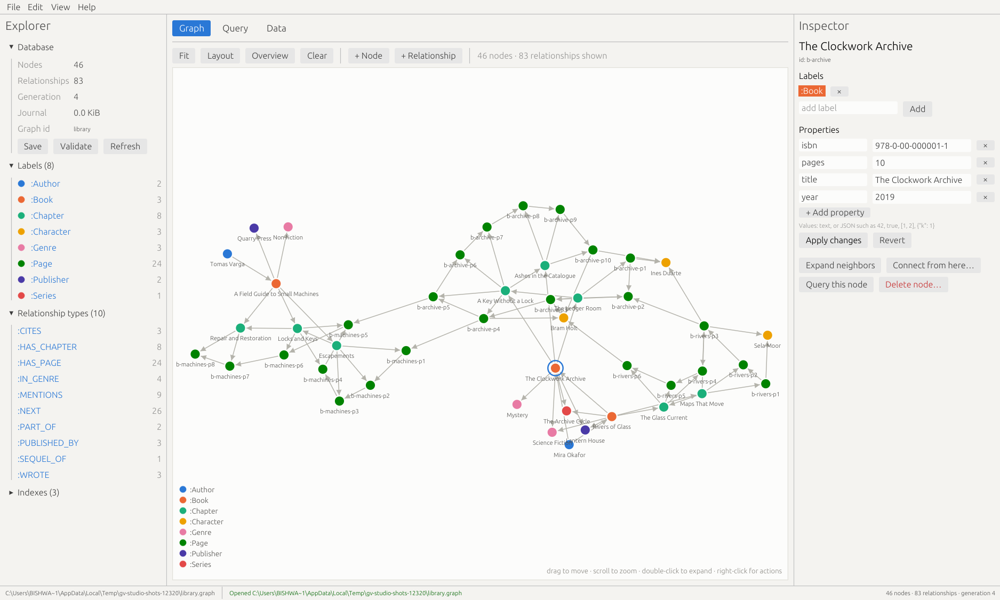
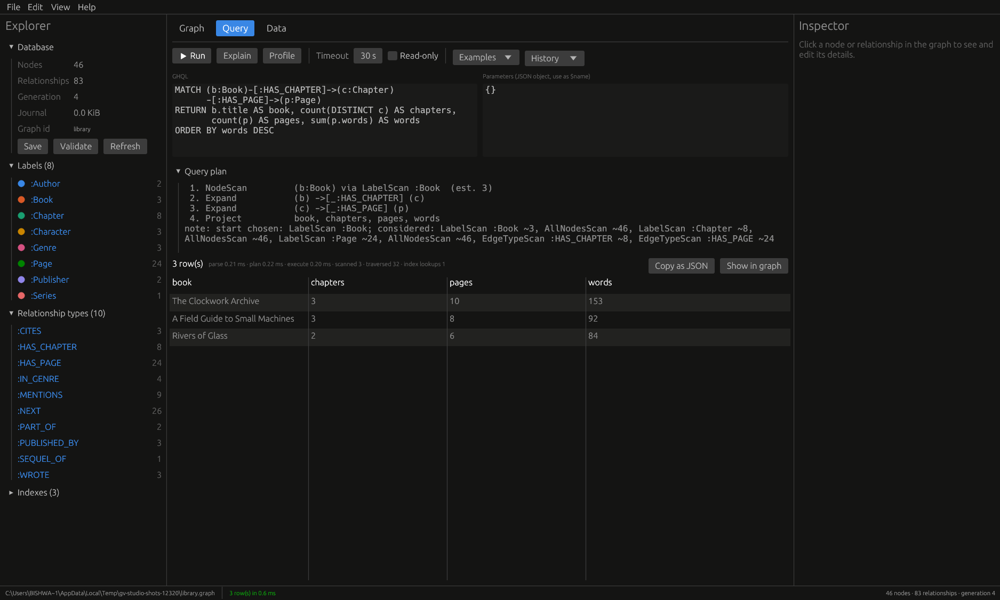
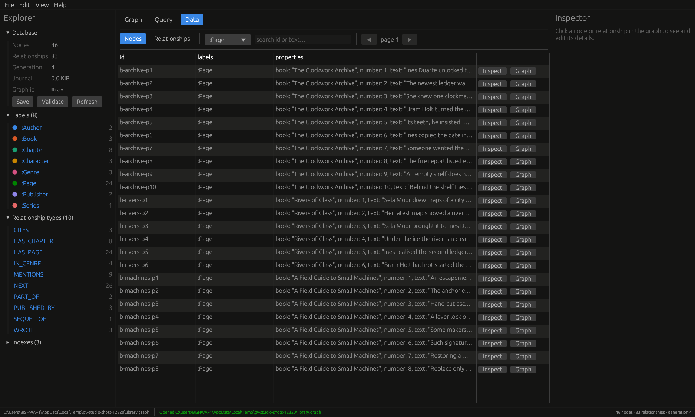
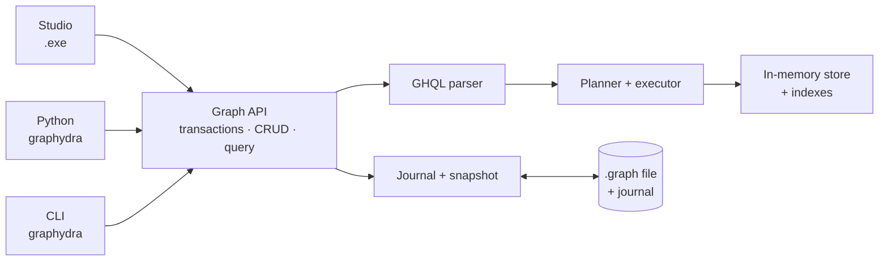
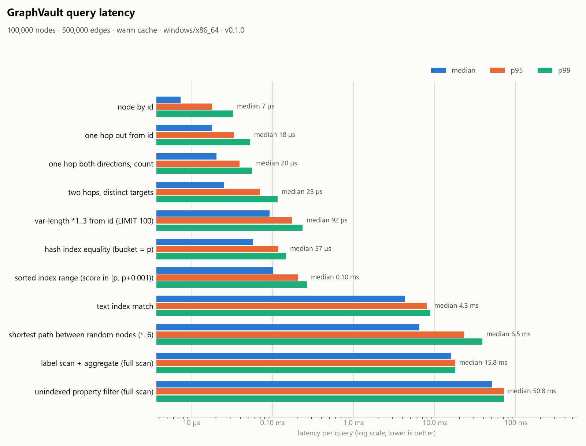
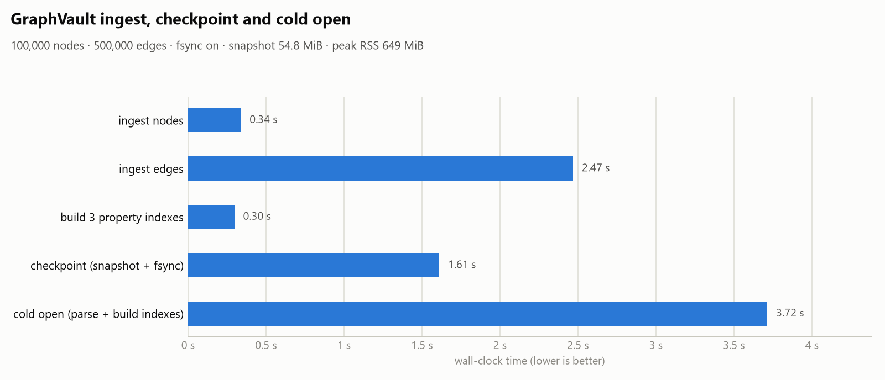

# GrapHydra

An embedded, local-first graph database. Graphs live in portable `.graph`
files, you query them with a declarative pattern language (GHQL), and every
change is an atomic, crash-safe transaction. There is no server to run.

<picture>
  <source media="(prefers-color-scheme: dark)" srcset="docs/images/studio-graph-dark.png">
  
</picture>

| Component | What it is |
|---|---|
| **GrapHydra Studio** (`graphydra-studio.exe`) | Desktop app: create databases, explore the graph visually, edit nodes and relationships, run queries |
| **Python package** (`pip install graphydra`) | Typed API over the engine; queries release the GIL |
| **CLI** (`graphydra`) | `init`, `validate`, `info`, `query`, `explain`, `index`, `import` / `export`, `checkpoint`, `shell` |
| **Rust core** (`graphydra-core`) | Storage, journal, indexes, query planner and executor, shared by all of the above |

## Quick start

**Python**

```bash
pip install graphydra
```

```python
from graphydra import Graph

with Graph.open("library.graph", create=True) as g:
    g.add_node("a-okafor", ["Author"], {"name": "Mira Okafor"})
    g.add_node("b-archive", ["Book"], {"title": "The Clockwork Archive", "year": 2019})
    g.add_edge("wrote-1", "a-okafor", "b-archive", "WROTE")

    rows = g.query(
        "MATCH (a:Author)-[:WROTE]->(b:Book) WHERE a.name = $name RETURN b.title AS title",
        {"name": "Mira Okafor"},
    )
    print(rows.to_list())  # [{'title': 'The Clockwork Archive'}]
```

**Studio:** run `graphydra-studio.exe`, then **File → New sample database…**
for data to explore, or open any `.graph` file. See the
[Studio guide](docs/studio.md).

**CLI**

```bash
graphydra init library.graph
graphydra query library.graph "CREATE (:Book {id: 'b1', title: 'Rivers of Glass'})"
graphydra query library.graph "MATCH (b:Book) RETURN b.title"
graphydra shell library.graph
```

## GrapHydra Studio

A native Windows app: one 8 MB `.exe` with no installer or runtime.

| Query tab | Data tab |
|---|---|
|  |  |

* **Create and open** databases, including a sample, plus read-only mode;
  a file locked by another writer opens read-only automatically.
* **See the graph:** force-directed layout, pan, zoom, drag, colors by label,
  double-click to expand neighbors, and a right-click menu.
* **Edit visually:** create nodes and relationships, edit properties and
  labels in the Inspector, and delete with confirmation.
* **Query:** GHQL editor with parameters, **Ctrl+Enter** to run,
  Explain and Profile, Cancel for long queries, history, built-in examples,
  and "Show in graph" for any result.
* **Browse data:** paginated tables of nodes and relationships with label
  filters and search.
* **Manage:** indexes, transactions, validation, and import/export (JSON,
  JSON Lines, CSV, GraphML).

## Examples

| | |
|---|---|
| [Writing queries](examples/writing-queries.md) | GHQL step by step, from first pattern to indexes and common mistakes |
| [Library: books, chapters, pages](examples/library/README.md) | A complete hierarchical model with 22 example queries, [their real output](examples/library/RESULTS.md), and a Python API tour |

Every query in the examples runs in the test suite, so the documentation
can't drift from the engine.

## Query language at a glance

```cypher
MATCH (a:Author)-[:WROTE]->(b:Book) RETURN a.name, b.title ORDER BY b.year
MATCH (b:Book {title: $title})-[:HAS_CHAPTER]->(c)-[:HAS_PAGE]->(p) RETURN c.title, count(p) AS pages
MATCH (p:Page {number: 3})-[:NEXT*1..3]->(n) RETURN n.number, n.text
MATCH (p:Page) WHERE text_match(p.text, "brass key") RETURN p.book, p.number
MATCH path = shortestPath((a {id: 'a-varga'})-[*..8]-(c {id: 'c-bram'})) RETURN length(path)
CREATE (a:Author {name: 'Hedda Lind'})-[:WROTE]->(b:Book {title: 'Salt Roads'}) RETURN a, b
MATCH (b:Book {title: 'Salt Roads'}) SET b.year = 2026, b:Draft
MATCH (b:Book {title: 'Salt Roads'}) DETACH DELETE b
CREATE SORTED INDEX ON NODES(year)
EXPLAIN MATCH (b:Book) WHERE b.year > 2018 RETURN b
```

Learn it in [Writing queries](examples/writing-queries.md); the complete
grammar, semantics, functions, and limits are in the
[query language reference](docs/query-language.md).

## Why it's reliable

| Guarantee | How |
|---|---|
| No partial commits | Every mutation runs in a transaction; a failing statement is undone completely, even inside an explicit transaction. |
| Crash safety | Commits are fsynced to a checksummed append-only journal. Snapshots are replaced atomically (`fsync` + rename / `MoveFileExW(WRITE_THROUGH)`). On open, committed records are replayed and a torn final record is discarded. The tests cut the journal at every byte offset and kill writer processes mid-transaction. |
| Referential integrity | Unique ids, no dangling edges, and node deletion refuses incident edges unless `DETACH`. |
| Strict file parsing | Duplicate JSON keys, unknown fields, out-of-range numbers, unsupported versions and oversized or over-nested values are rejected. Files are never executed. |
| Indexes can't change answers | Indexes only narrow candidate sets and the original predicate is always re-checked. Property tests compare indexed, unindexed and brute-force results on random graphs. |
| Bounded execution | Traversals must be bounded (`*1..3`). Every query has visit and row budgets, timeouts and cancellation, and the parser has a nesting-depth limit. |
| Safe query input | `$parameters` instead of string building; the language has no procedures, file access or code evaluation. |
| Single writer, many readers | An OS lock on `<file>.lock` makes a second writer fail fast; read-only handles take no lock and see a consistent snapshot. |

## Architecture



Commit, recovery, and query-execution diagrams are in
[docs/architecture.md](docs/architecture.md); the on-disk format and crash
windows are in [docs/file-format.md](docs/file-format.md).

## Performance

These numbers are from one run with 100,000 nodes and 500,000 edges on a
laptop (Intel i5-1145G7, Windows 11, release build, fsync on). Methodology,
the raw tables and how to reproduce them are in
[docs/performance.md](docs/performance.md).

<picture>
  <source media="(prefers-color-scheme: dark)" srcset="docs/benchmarks/results-100k-500k-latency-dark.png">
  
</picture>

<picture>
  <source media="(prefers-color-scheme: dark)" srcset="docs/benchmarks/results-100k-500k-phases-dark.png">
  
</picture>

These are measurements on one machine, not guarantees. Full scans grow
linearly with graph size; indexed lookups and adjacency expansion do not.

## Build from source

Requirements: Rust 1.89+ (MSVC toolchain on Windows), and Python 3.9+ for
the bindings.

```bash
cargo build --release          # target/release/graphydra(.exe) and graphydra-studio(.exe)
cargo test --workspace --exclude graphydra-py
```

```bash
pip install maturin
maturin develop --release      # installs the graphydra package into the active virtualenv
pytest
```

```bash
cargo install --path crates/graphydra-cli      # puts `graphydra` on PATH
cargo install --path crates/graphydra-studio   # puts `graphydra-studio` on PATH
```

On Linux, Studio needs `libgtk-3-dev` and `libxkbcommon-dev` to build.

To regenerate the Studio screenshots in this README:
`cargo test -p graphydra-studio --release -- --ignored readme_screenshots`.

## CLI reference

```bash
graphydra init cybersecurity.graph
graphydra import cybersecurity.graph --format json input.json
graphydra validate cybersecurity.graph
graphydra info cybersecurity.graph
graphydra query cybersecurity.graph "MATCH (h:Host) WHERE h.id = \$id RETURN h" -p id=host-001
graphydra --json query cybersecurity.graph "MATCH (h:Host) RETURN h.id LIMIT 10"
graphydra query cybersecurity.graph -f script.ghql --read-only
graphydra explain cybersecurity.graph "MATCH (h:Host) WHERE h.id = 'host-001' RETURN h"
graphydra index create cybersecurity.graph risk_score --kind sorted
graphydra index rebuild cybersecurity.graph
graphydra export cybersecurity.graph --format graphml --output graph.graphml
graphydra shell cybersecurity.graph
```

Exit codes: `0` ok, `1` I/O or internal error, `2` usage, `3` query error,
`4` invalid file, `5` locked by another writer, `6` not found.

## Rust API

```rust
use graphydra_core::{Graph, Node, Edge, QueryOptions};

let mut g = Graph::open_with("cyber.graph", graphydra_core::OpenOptions::new().create(true))?;
g.transaction(|g| {
    g.add_node(Node::new("a").with_label("Host"))?;
    g.add_node(Node::new("b").with_label("Malware"))?;
    g.add_edge(Edge::new("e", "a", "b", "DETECTED"))
})?;
let r = g.query("MATCH (a)-[:DETECTED]->(b) RETURN b.id", &QueryOptions::new())?;
g.close()?;
```

## Project layout

```
crates/graphydra-core     engine: model, storage, journal, indexes, GHQL parser, planner, executor
crates/graphydra-cli      `graphydra` command-line tool
crates/graphydra-studio   GrapHydra Studio desktop app (egui), with headless UI tests
crates/graphydra-py       PyO3 bindings (module graphydra._graphydra)
python/graphydra          Python package + type stubs; python/README.md is the PyPI page
tests/python              pytest + Hypothesis suite, including the examples
examples/                 query guide and the library example
scripts/plot_bench.py     renders benchmark JSON into the PNG charts above
docs/                     architecture, file format, query language, performance, Studio guide
```

## Documentation

* [GrapHydra Studio guide](docs/studio.md)
* [Writing queries](examples/writing-queries.md) and the [library example](examples/library/README.md)
* [GHQL query language reference](docs/query-language.md)
* [Architecture and design decisions](docs/architecture.md)
* [`.graph` file format, journal, recovery and concurrency](docs/file-format.md)
* [Performance and benchmarks](docs/performance.md)
* [Uploading to PyPI, step by step](PYPI_UPLOAD_GUIDE.md) and [automated releases](PUBLISHING.md)

## License

MIT OR Apache-2.0
