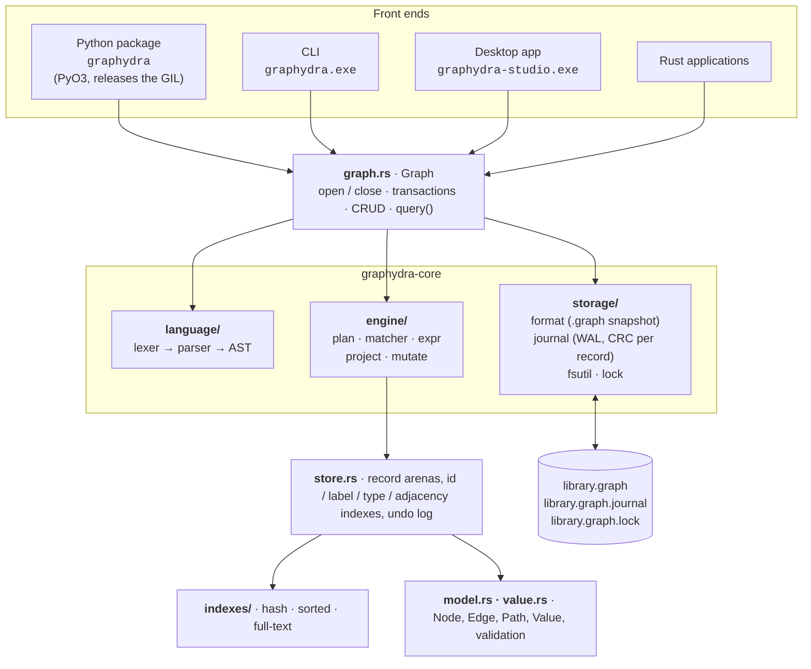
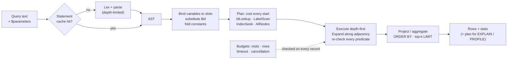
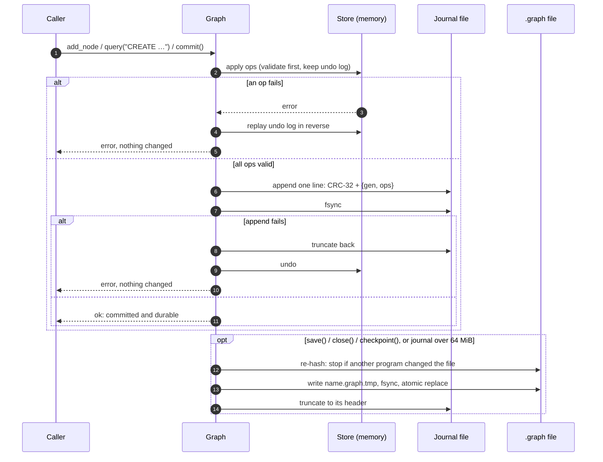
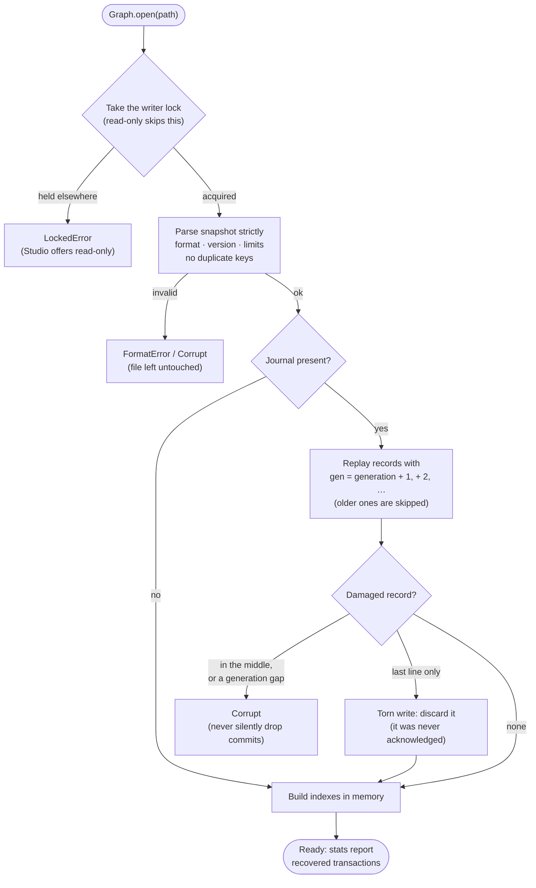
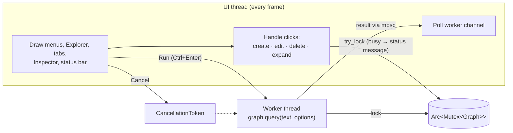

# Architecture

## Components

One Rust engine, `graphydra-core`, serves every front end. Nothing talks to
the files except the storage layer.



## Layers

| Layer | Responsibility | Independent of |
|---|---|---|
| `model`, `value` | Data model, value types, validation rules | I/O, query syntax |
| `store` | Slot arenas (`Vec<Option<Rec>>`) with interned labels and types, and every derived structure. Each op is validated before anything changes, and returns an exact undo record | files, language |
| `indexes` | Property indexes. They return *supersets*; the executor re-checks predicates | everything above |
| `storage` | Snapshot read/write, journal, durability, locking | query engine |
| `language` | Tokenizer and recursive-descent parser producing an AST with positioned errors | storage |
| `engine` | Binding, planning, execution, projection, mutation | file format |
| `graph` | Transaction boundaries, persistence policy, public API | Nothing: it is the top layer |

The `.graph` format, the query language, the index engine and the APIs are
separate. Any one can change (for example a binary storage backend) without
touching the others.

## Key decisions

| Decision | Choice | Why |
|---|---|---|
| Implementation language | Rust core, PyO3 bindings | Memory safety without GC pauses, predictable performance, one engine for Python, the CLI, Studio and Rust users |
| Canonical encoding | Versioned UTF-8 JSON, strict | Inspectable, diffable, portable; strictness prevents silently accepting bad data |
| Durability | Logical-op journal + atomic snapshot replace | Commits cost O(changes), not O(graph). A checkpoint rewrites the file |
| Indexes | Built in memory on open, maintained incrementally | Cannot go stale; correctness is checked by `verify()` and property tests |
| Planner | Rule-based with exact cardinalities from index statistics | Deterministic and explainable; enough for a first release |
| Traversal semantics | Relationship-unique (trail) paths, bounded depth | Terminates on cycles and makes cost explicit |
| Update semantics | Match first, then mutate (snapshot) | No Halloween problem; statements are atomic |
| Node deletion | Reject while edges exist unless `DETACH` | Never orphans or silently removes relationships |
| Concurrency | One writer (OS lock), lock-free snapshot readers | Simple and correct; multi-writer is out of scope |
| Ids | Caller-supplied strings, immutable; generated if omitted | Stable across export/import |
| Async | None in the core | No concrete need; GIL release covers Python threading, and Studio uses a worker thread |
| Desktop UI | egui (immediate mode), one native `.exe` | No runtime or installer; the UI calls the engine directly instead of through a server |

## Executing a query

```cypher
MATCH (h:Host)-[:DETECTED]->(m:Malware) WHERE h.id = $id RETURN m.family
```



1. **Parse**, using the statement cache keyed by query text.
2. **Bind:** `h`, `m` and the anonymous edge get row slots. `$id` is
   substituted and constant expressions are folded.
3. **Plan:** the candidates for `h` are IdLookup (1), LabelScan :Host (n) and
   AllNodes (N). For `m` they are LabelScan :Malware and AllNodes. For the
   edge they are EdgeTypeScan :DETECTED and AllEdges. IdLookup wins, so the
   plan is `NodeScan h via IdLookup` → `Filter h.id = …` →
   `Expand (h)->[:DETECTED](m)` (checking the `:Malware` label inline) →
   `Project`.
4. **Execute** depth-first, binding slots in place and streaming rows into
   the projector. `LIMIT` stops matching early when there is no `ORDER BY`
   or aggregation. `ORDER BY … LIMIT k` keeps a bounded top-k buffer.
5. **Budget** checks run on every visited record: visit cap, timeout,
   cancellation.

## Committing a change

Every mutation, whether one API call or a whole `BEGIN … COMMIT`, becomes a
list of logical ops. Each op is applied to memory with an undo record first,
so a failure rolls back exactly. The commit is durable once its journal
record is flushed to disk.



## Opening and recovery



The file format, journal framing and the crash windows covered by tests are
described in [file-format.md](file-format.md).

## GrapHydra Studio

Studio is an immediate-mode UI ([egui](https://github.com/emilk/egui)): every
frame redraws from application state, so there is no separate view model to
keep in sync. Queries run on a worker thread, so a slow query never freezes
the window and can be cancelled.



| Part | File | Notes |
|---|---|---|
| App state, menus, panels, dialogs | `crates/graphydra-studio/src/app.rs` | All mutations go through the public `Graph` API |
| Graph canvas | `graph_view.rs` | Force-directed layout (O(n²), capped at 1,500 visible nodes), pan / zoom / drag, hit-testing |
| Theme | `theme.rs` | Light and dark palettes; label colors use the same colorblind-safe set as the charts |
| Headless UI tests | `ui_tests.rs` | Drive the real app through its accessibility tree with `egui_kittest`; also render the README screenshots |

## Testing strategy

| Suite | What it proves |
|---|---|
| Unit tests (in modules) | Value comparison exactness, index keys, tokenizer, lexer and parser, journal framing, adjacency and undo exactness |
| `tests/query.rs` | Every example in the design document, semantics, errors, limits, explain output |
| `tests/persistence.rs` | Reopen equality, recovery after a journal cut **at every byte**, a crash between rename and journal reset, locking, external modification, malformed or malicious files |
| `tests/properties.rs` | Property-based tests on random graphs: indexed = unindexed = brute force, exact rollback, journal replay and snapshot round trip, failed parses never mutate |
| `tests/interop_security.rs` | Import/export round trips, atomic imports, escaping, pathological queries, no escape hatches |
| `crates/graphydra-cli/tests` | The end-to-end CLI workflow, exit codes, JSON errors, the shell |
| `crates/graphydra-studio` | Value parsing, every built-in example query, and UI flows: open, query, read-only mode, create, edit, delete with confirmation, data browser, expand, transactions, locked-file fallback |
| `tests/python` | The Python API, error hierarchy, transactions, cross-process locking, a hard-kill crash, threads, cancellation, Hypothesis value round trips, and the `examples/library` scripts |

## Extension points

* **Storage backends:** `storage::format` and `storage::journal` are the only
  modules that touch files. A binary or memory-mapped backend can replace
  them behind the same `Graph` API.
* **Index kinds:** add a variant to `IndexKind` and `IndexData` and teach
  `plan::index_candidates` which predicates it serves. The planner always
  re-checks predicates, so a new index only has to return a superset.
* **Functions:** add an entry to the `funcs!` table in `engine/expr.rs`.
