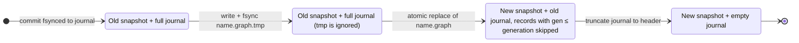

# `.graph` file format, journal, recovery and concurrency

## Files

| File | Role | Safe to delete? |
|---|---|---|
| `name.graph` | Canonical snapshot (portable, UTF-8 JSON) | no |
| `name.graph.journal` | Committed transactions newer than the snapshot | **no**, unless the writer closed cleanly |
| `name.graph.lock` | Held (OS lock) by the single writer | yes, when no process has the graph open |
| `name.graph.tmp` | Snapshot being written; removed on the next writable open | yes |

Indexes are derived data. They are rebuilt in memory from the records when a
graph is opened, so there is no index file that can go stale or be tampered
with. Index *definitions* are part of the snapshot.

## Snapshot format 1.0

```json
{
  "format": "graphydra",
  "format_version": "1.0",
  "graph_id": "cybersecurity-demo",
  "generation": 12,
  "metadata": {"description": "Example"},
  "indexes": [{"kind": "sorted", "target": "node", "property": "risk_score"}],
  "nodes": [
    {"id":"host-001","labels":["Host"],"properties":{"hostname":"workstation-01","risk_score":0.92}}
  ],
  "edges": [
    {"id":"edge-001","source":"host-001","target":"malware-001","type":"DETECTED","properties":{"confidence":0.97}},
    {"id":"edge-002","source":"a","target":"b","type":"PEER","directed":false,"properties":{}}
  ]
}
```

Rules, enforced on every read:

1. `format` must be `"graphydra"`. `"graphforge"` (the name in the original
   design document) is also accepted on read.
2. `format_version` must be `1.x` with `x ≤ 0`. Newer minors and other majors
   fail with `UnsupportedVersion` and are never guessed at.
3. Unknown fields anywhere are rejected (compatibility policy: *reject*), as
   are duplicate JSON keys and duplicate fields.
4. Node and edge ids must be unique, non-empty, at most 1 KiB, and free of
   control characters.
5. Every edge endpoint must exist. `directed` defaults to `true`.
6. Labels within a node must be unique. Labels, edge types and property keys
   must be non-empty and at most 256 bytes.
7. The property key `id` is reserved, because `n.id` means the entity id.
8. Values are null, booleans, signed 64-bit integers, finite floats, strings,
   lists and string-keyed maps.
   * Integers outside the signed 64-bit range, `NaN` and `±Infinity` are rejected.
   * Default limits: nesting depth ≤ 32, string ≤ 16 MiB, file ≤ 8 GiB.
     All are configurable through `Limits`.
9. Nothing in a file is ever executed, and no path or URL in a file is followed.

Writers emit canonical output:
* Map keys are sorted.
* One record per line, in a stable order.
* Floats use the shortest representation that round-trips.

The result diffs well in version control.

## Journal (write-ahead log)

```
{"journal":"graphydra","version":1,"graph_id":"cybersecurity-demo"}
3f2a9c1b {"gen":13,"ops":[{"op":"add_node","node":{...}},{"op":"set_node_property",...}]}
```

* One line per committed transaction: an 8-hex-digit CRC-32 of the payload,
  a space, then the JSON payload.
* The ops are logical (`add_node`, `add_edge`, `delete_node`, `delete_edge`,
  `set_node_property`, `set_edge_property`, `add_label`, `remove_label`,
  `create_index`, `drop_index`, `set_metadata`), so replay is deterministic.

### Commit protocol

1. Every op is validated as it is applied in memory, with an undo record kept.
2. On commit, the record is appended to the journal and fsynced
   (`Durability::Full`, the default). **The transaction is durable once this
   returns.**
3. If the append fails, the journal is truncated back and the in-memory
   changes are undone. If even the truncation fails, the handle becomes
   `Poisoned` and refuses further writes.

### Checkpoint

A checkpoint runs on `checkpoint()` / `save()` / `close()`, or automatically
once the journal exceeds 64 MiB.

1. Re-hash the current snapshot file. If it no longer matches what this
   process last wrote or read, stop with `ExternalModification` instead of
   overwriting someone else's edit.
2. Write `name.graph.tmp`, fsync it, then atomically replace `name.graph`.
   * Unix: `rename` + fsync of the directory.
   * Windows: `MoveFileExW(REPLACE_EXISTING | WRITE_THROUGH)`, retried briefly
     on sharing violations caused by scanners and indexers.
3. Truncate the journal to its header.

The snapshot's `generation` field makes this crash-safe at every point:



A crash in any state reopens to the same logical graph:

| Crash point | State on next open |
|---|---|
| During step 1 or 2 | Old snapshot + full journal; nothing lost |
| Between steps 2 and 3 | New snapshot + old journal; records with `gen ≤ generation` are skipped |
| After step 3 | New snapshot + empty journal |

### Recovery on open

1. Validate the snapshot.
2. Replay the journal records with `gen = generation + 1, +2, ...`.
   * A gap in generations, or a damaged record that is *not* the last line,
     is `Corrupt`: committed data would otherwise be silently lost.
   * A damaged or incomplete **last** line is a torn write from a crash
     during commit. The transaction never became durable, so it is discarded
     (and truncated when opened for writing).
3. `Graph.stats()` reports `recovered_transactions` and `recovered_torn_write`.

`graphydra validate` performs all of these checks without modifying anything.

## Concurrency model

* **One writer per file.** A writable open takes an exclusive OS lock
  (`LockFileEx` / `flock`) on `name.graph.lock` for the life of the handle.
  A second writer in any process fails immediately with `Locked`.
* **Any number of readers.** `open(read_only=True)` takes no lock and loads
  the snapshot plus committed journal records. It sees a consistent state as
  of open time; `refresh()` reloads newer commits. Readers never block the writer.
* **Within one handle**, operations are serialized. In Python one `Graph`
  object can be shared between threads; queries release the GIL. Uncommitted
  changes of an open transaction are visible only through that handle.
* **Network filesystems** (SMB/NFS) are not supported: advisory locks and
  rename atomicity are not reliable there.
* **Multi-writer concurrency is not supported**, deliberately.

## Interchange formats

| Format | Import | Export | Notes |
|---|---|---|---|
| JSON | ✓ | ✓ | full `.graph` document or `{"nodes": [...], "edges": [...]}` |
| JSON Lines | ✓ | ✓ | one object per line with `"kind": "node"` or `"edge"` |
| CSV | ✓ | ✓ | separate nodes and edges files; typed headers `score:float`, `tags:json`; `labels` is `;`-separated |
| GraphML | – | ✓ | properties typed when consistent; nested values are JSON strings |

Imports are atomic and strict:
* Unknown fields, bad numbers, duplicates and dangling edges abort the whole
  import.
* Edges without ids get generated ones.
