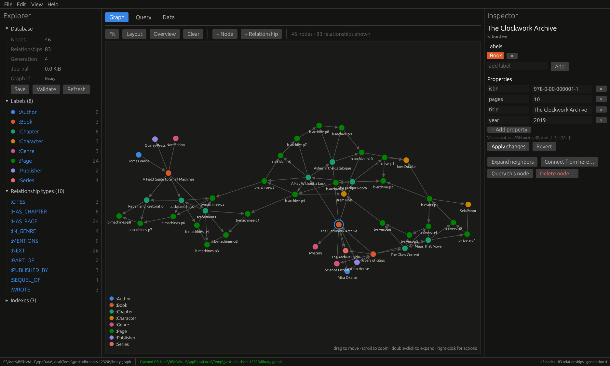
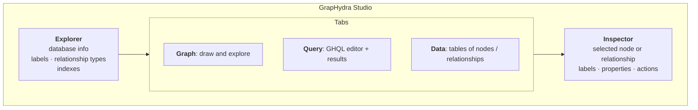
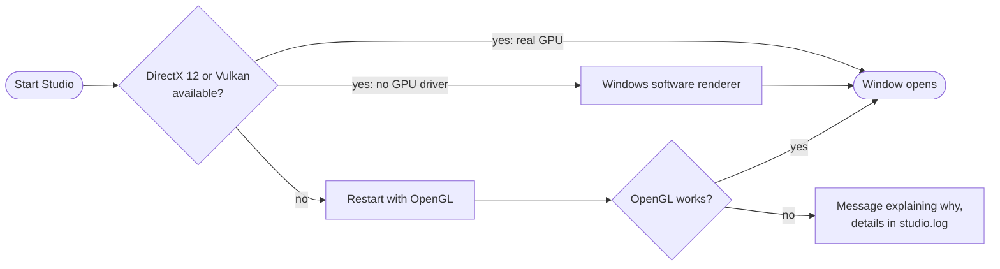

# GrapHydra Studio

A desktop app for `.graph` databases: create them, see and explore the
graph, edit nodes and relationships, and run queries. It is a single
Windows executable, `graphydra-studio.exe`, with no installer or runtime.
Download it from the repository's [`bin/`](../bin/README.md) folder.



## Getting started

| To | Do |
|---|---|
| Start with example data | **File → New sample database…** (a small security-incident graph), or open [`examples/library`](../examples/library/README.md) |
| Create an empty database | **File → New database…** and choose where to save the `.graph` file |
| Open a database | **File → Open…** (**Ctrl+O**), **File → Open recent**, or run `graphydra-studio.exe path\to\file.graph` |
| Look without changing anything | **File → Open read-only…** |

Only one program can write to a database at a time. If another program (a
script or a second Studio window) has the file open for writing, Studio opens
it read-only and says so in the status bar.

## The window



The **status bar** shows the file, a **READ-ONLY** badge, a
**TRANSACTION OPEN** marker while a transaction is active, the result of the
last action (errors in red), and node, relationship, and generation counts.

## Exploring the graph

When a database opens, the Graph tab draws up to 300 nodes. To focus:

* Click a **label** (`:Book`) or **relationship type** (`:WROTE`) in the
  Explorer to draw just those.
* **Double-click** a node to add its neighbors. Repeat to walk outward.
* **Overview** redraws the first 300 nodes; **Clear** empties the canvas
  without changing any data.

| Action | How |
|---|---|
| Pan | Drag the background |
| Zoom | Mouse wheel (zooms around the pointer) |
| Move a node | Drag it; it stays pinned where you drop it |
| Select | Click a node or relationship; details appear in the Inspector |
| More actions | Right-click a node: expand, connect, pin or unpin, hide, delete |
| Re-arrange | **Layout** re-runs the automatic layout; **Fit** zooms to show everything |

Nodes are colored by their first label, and the legend lists the labels on
screen. The first eight labels (alphabetically) get distinct colors; any
more are gray, so no two labels ever share a color. Relationship names show
when the graph is small or zoomed in. At most 1,500 nodes are drawn at once;
narrow the view with a query for bigger graphs.

## Creating and editing

| To | Do |
|---|---|
| Add a node | **+ Node**, **Edit → New node…** or **Ctrl+N**. The id is optional (one is generated). Labels are comma-separated |
| Add a relationship | **+ Relationship**, **Ctrl+E**, or right-click a node → **Connect from here…**. Pick the source and target from the nodes on screen or type their ids |
| Edit properties | Select, change values in the Inspector, then **Apply changes**. **Revert** discards your edits. Remove a row with **×** to delete that property |
| Add or remove labels | In the Inspector: type a label and press **Add**, or **×** on a label |
| Delete | **Delete node…** or **Delete relationship…** in the Inspector, or the right-click menu. You confirm first. Deleting a node also deletes its relationships |

**Property values** are typed as JSON when they look like JSON, and as text
otherwise: `42` is a number, `true` a boolean, `[1, 2]` a list,
`{"k": 1}` a map, and `Ada` or `"Ada"` the text Ada. Malformed JSON such as
`{oops` is rejected, not silently stored as text.

Every change is saved the moment it is made: it is committed to the
database's journal on disk. **Save** (**Ctrl+S**) additionally folds the
journal into the main `.graph` file, which also happens automatically on
close.

### Transactions

To group several edits so they all happen or none do, use
**Edit → Begin transaction**, make the edits, then **Commit transaction** or
**Roll back transaction**. While a transaction is open, the status bar shows
**TRANSACTION OPEN**. If you close the database with a transaction open,
Studio asks whether to discard it. Quitting the app discards an open
transaction without asking, so commit first.

## Running queries


1. Type a GHQL query, or pick one from **Examples** or **History**.
2. Put values in **Parameters** as a JSON object, for example
   `{"title": "Rivers of Glass"}`, and use them as `$title`.
3. Press **Ctrl+Enter** or **▶ Run**.

| Control | Effect |
|---|---|
| **Explain** | Shows the plan without running the query |
| **Profile** | Runs it and shows the plan with counts |
| **■ Cancel** | Stops a running query (the window stays responsive) |
| **Timeout** | Seconds before a query is stopped; `0` means no limit |
| **Read-only** | Rejects any statement that would change data |
| **Show in graph** | Draws every node, relationship, and path in the results |
| **Copy as JSON** | Copies the result rows to the clipboard |

Errors appear above the results with their position in the query.
**Help → Query language guide** lists examples you can load with one click.
New to GHQL? Read [Writing queries](../examples/writing-queries.md).

## Browsing data


The Data tab lists **Nodes** or **Relationships** 100 at a time. Filter by
label or type, search ids and text values, and page with ◀ ▶. **Inspect**
selects a row in the Inspector; **Graph** draws it.

## Indexes and maintenance

* **Indexes** (Explorer): see each index's size, drop one with **×**, or
  create one. Choose *hash* for equality, *sorted* for ranges and prefixes,
  and *text* for full-text search. Indexes speed queries up and never
  change their results.
* **Validate** checks the file's structure and the indexes without changing
  anything.
* **Refresh** re-reads a database opened read-only, picking up changes
  another program committed.
* **File → Save a copy as…** writes a snapshot to a new file.

## Import and export

**File → Import** loads JSON, JSON Lines, or CSV (you are asked for a nodes
file, then an edges file; cancel either to skip it). Imports are
all-or-nothing.

**File → Export** writes JSON, JSON Lines, GraphML (for Gephi, yEd,
Cytoscape), or CSV. For CSV, the name you choose becomes a prefix:
`library` gives `library.nodes.csv` and `library.edges.csv`, the same as
`graphydra export --format csv -o library`.

## Keyboard shortcuts

| Shortcut | Action |
|---|---|
| **Ctrl+O** | Open a database |
| **Ctrl+S** | Save |
| **Ctrl+N** | New node |
| **Ctrl+E** | New relationship (from the selected node, if any) |
| **Ctrl+Enter** | Run the query |

## Preferences

Theme (**View → Dark theme**), recent files, and query history are stored
in `%APPDATA%\GrapHydra\studio.json`. Set `GRAPHYDRA_STUDIO_SETTINGS` to
another path to keep them elsewhere, for example next to a portable copy of
the app.

## If Studio doesn't start

Studio needs nothing installed: the C runtime is built into the `.exe`, and
it picks a way to draw automatically:



Every start, and every startup error or crash, is written to
`%APPDATA%\GrapHydra\studio.log`; **Help → About** shows the graphics
adapter in use. Two environment variables help diagnose drawing problems:

| Variable | Effect |
|---|---|
| `GRAPHYDRA_GRAPHICS=software` | Use Windows' software renderer even if a GPU exists. Fixes black or garbled windows caused by a broken graphics driver |
| `GRAPHYDRA_RENDERER=opengl` | Skip DirectX and Vulkan and draw with OpenGL |

For example, in PowerShell:

```powershell
$env:GRAPHYDRA_GRAPHICS = "software"; .\graphydra-studio.exe
```

More fixes (SmartScreen, 32-bit Windows, Remote Desktop) are in
[bin/README.md](../bin/README.md#if-it-doesnt-open).
