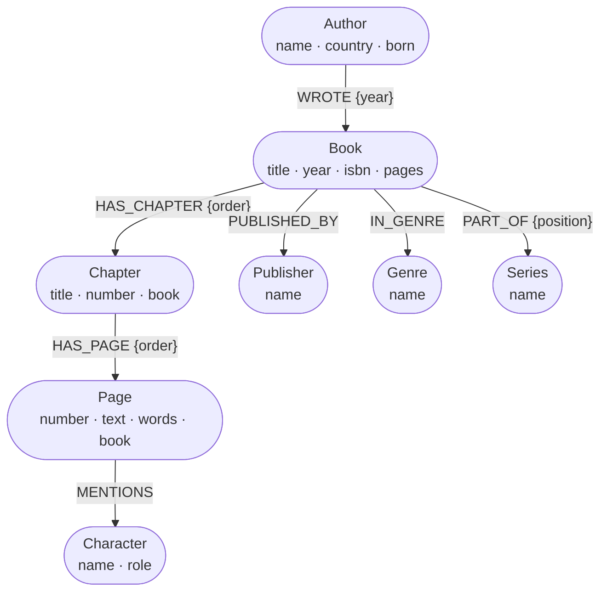

# Library example: books, chapters, and pages

A complete, small graph you can build, query, and open in GrapHydra Studio.
Three invented books by two authors are broken into chapters and pages, with
characters, citations between books, genres, publishers, and a series.

| | |
|---|---|
| Nodes | 46: 2 authors, 3 books, 8 chapters, 24 pages, 3 characters, 3 genres, 2 publishers, 1 series |
| Relationships | 83 across 10 types |
| Indexes | sorted `title`, hash `name`, sorted `number`, full-text `text` |

## The model



Four relationships connect nodes of the same kind:

| Relationship | Meaning |
|---|---|
| `(:Chapter)-[:NEXT]->(:Chapter)` | Chapter reading order within a book |
| `(:Page)-[:NEXT]->(:Page)` | Page reading order, continuous through a book |
| `(:Page)-[:CITES {note}]->(:Page)` | A page referring to a page in another book |
| `(:Book)-[:SEQUEL_OF]->(:Book)` | *Rivers of Glass* follows *The Clockwork Archive* |

Design choices worth copying:

* **Order lives on the relationship.** `HAS_CHAPTER {order}` and
  `HAS_PAGE {order}` say where a chapter sits in its book and a page sits in
  its chapter, so reordering means changing one relationship.
* **`NEXT` links give reading order.** Turning pages is a one-hop traversal
  (`-[:NEXT]->`), and "the next three pages" is `-[:NEXT*1..3]->`, with no
  sorting needed.
* **Pages also store `number` and `book`.** These are denormalized on
  purpose: they let indexed lookups like "page 7 of this book" start directly
  at the page instead of walking from the book.
* **Ids are readable and stable** (`b-archive`, `b-archive-ch2`,
  `b-archive-p5`), so imports, exports, and diffs stay meaningful.

## Build it

```bash
pip install graphydra
python examples/library/build_library.py
```

This writes `library.graph` (not committed; regenerate it any time) and
refreshes `library.json`, the committed copy of the data.

No Python? Load the JSON with the CLI instead:

```bash
graphydra import examples/library/library.graph --format json examples/library/library.json
graphydra index create examples/library/library.graph text --kind text
graphydra index create examples/library/library.graph number --kind sorted
```

## Query it

| File | What it shows |
|---|---|
| [`queries.ghql`](queries.ghql) | 14 read-only queries, from a simple join to aggregation, variable-length paths, full-text search, and shortest paths |
| [`writes.ghql`](writes.ghql) | 8 statements that add a chapter and pages, update, re-label, and delete |
| [`RESULTS.md`](RESULTS.md) | The actual output of every query above (regenerated and checked by the tests) |
| [`run_queries.py`](run_queries.py) | Runs either file and prints Markdown tables |
| [`library_api.py`](library_api.py) | The same data through the Python API: parameters, `neighbors`, `search_text`, `shortest_path`, and a transaction that rolls back |

```bash
python examples/library/run_queries.py              # read examples
python examples/library/run_queries.py --writes     # write examples, on a temporary copy
python examples/library/library_api.py               # Python API tour

graphydra query examples/library/library.graph -f examples/library/queries.ghql --read-only
graphydra shell examples/library/library.graph       # interactive
```

A taste of the results (all of them are in [RESULTS.md](RESULTS.md)):

```cypher
// The next three pages after page 3, following NEXT links
MATCH (p:Page {book: "The Clockwork Archive", number: 3})-[:NEXT*1..3]->(n:Page)
RETURN n.number AS page, n.text AS text
ORDER BY page
```

| page | text |
|------|------|
| 4 | Bram Holt turned the key under his loupe and said it opened nothing he had ever built. |
| 5 | Its teeth, he insisted, were not teeth at all but a date written in gears. |
| 6 | Ines copied the date into her notebook: the night the old archive burned. |

```cypher
// Size of each book: chapters, pages, and words
MATCH (b:Book)-[:HAS_CHAPTER]->(c:Chapter)-[:HAS_PAGE]->(p:Page)
RETURN b.title AS book, count(DISTINCT c) AS chapters, count(p) AS pages, sum(p.words) AS words
ORDER BY words DESC
```

| book | chapters | pages | words |
|------|----------|-------|-------|
| The Clockwork Archive | 3 | 10 | 153 |
| A Field Guide to Small Machines | 3 | 8 | 92 |
| Rivers of Glass | 2 | 6 | 84 |

## Explore it in GrapHydra Studio

```bash
graphydra-studio examples/library/library.graph
```

Or start Studio and use **File → Open…**, or **File → New database…** then
**File → Import → JSON…** with `library.json`. Then:

* Click **:Book** in the Explorer to draw just the books; double-click one to
  expand its chapters, and again to expand pages.
* Click a page to see its text in the Inspector, and edit it there.
* In the **Query** tab, open **Examples** or paste any query from
  `queries.ghql`, press **Ctrl+Enter**, then **Show in graph**.


New to the query language? Start with [Writing queries](../writing-queries.md).
