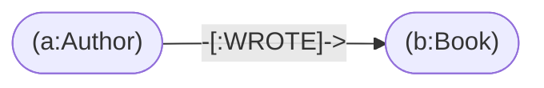
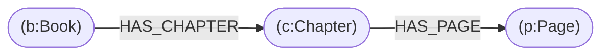

# Writing queries

A hands-on guide to GHQL, the GrapHydra query language. Every query here runs
against the [library example](library/README.md). Build it once, then follow
along in the CLI shell, the Python API, or the Query tab of GrapHydra Studio:

```bash
python examples/library/build_library.py
graphydra shell examples/library/library.graph
```

The full grammar and function list are in the
[query language reference](../docs/query-language.md).

## 1. Think in patterns

A query describes a shape to find. Nodes go in parentheses, relationships in
brackets with an arrow:



```cypher
MATCH (a:Author)-[:WROTE]->(b:Book)
RETURN a.name, b.title
```

* `a` and `b` are **variables**; you choose the names.
* `:Author` and `:Book` are **labels**; `:WROTE` is a **relationship type**.
* `RETURN` picks what comes back, here two properties.

Every statement either ends in `RETURN` or changes data (`CREATE`, `SET`,
`REMOVE`, `DELETE`).

## 2. Filter

Put exact matches inside the pattern, and anything else in `WHERE`:

```cypher
MATCH (b:Book {title: "Rivers of Glass"})
RETURN b.year, b.isbn
```

```cypher
MATCH (b:Book)
WHERE b.year >= 2019 AND b.title STARTS WITH "The"
RETURN b.title, b.year
```

Useful operators: `=`, `<>`, `<`, `<=`, `>`, `>=`, `AND`, `OR`, `NOT`, `IN [...]`,
`CONTAINS`, `STARTS WITH`, `ENDS WITH`, `IS NULL`, `IS NOT NULL`.

## 3. Use parameters for values

Never paste user input into query text. Write `$name` and pass the value
separately. It is safer (no injection) and faster (the parsed plan is reused):

```cypher
MATCH (b:Book {title: $title})-[h:HAS_CHAPTER]->(c:Chapter)
RETURN h.order AS chapter, c.title AS title
ORDER BY chapter
```

```python
g.query(query, {"title": "The Clockwork Archive"})
```

```bash
graphydra query library.graph "MATCH (b:Book {title: \$title}) RETURN b" -p title="Rivers of Glass"
```

In Studio, put `{"title": "Rivers of Glass"}` in the **Parameters** box.

## 4. Shape the output

```cypher
MATCH (p:Page)
WHERE p.book = "The Clockwork Archive"
RETURN p.number AS page, p.words AS words
ORDER BY words DESC, page
SKIP 2
LIMIT 3
```

* `AS` names a column.
* `ORDER BY` sorts (`DESC` for descending); add a second key to break ties,
  so results are stable.
* `SKIP` and `LIMIT` page through results.
* `RETURN DISTINCT` removes duplicate rows.

## 5. Follow relationships, several hops at once

Chain relationships to walk further. A book's pages are two hops away:



```cypher
MATCH (b:Book {title: "Rivers of Glass"})-[:HAS_CHAPTER]->(c:Chapter)-[:HAS_PAGE]->(p:Page)
RETURN c.title AS chapter, p.number AS page
ORDER BY page
```

Direction matters: `-->` outgoing, `<--` incoming, `--` either way.

```cypher
MATCH (ch:Character {name: "Sela Moor"})<-[:MENTIONS]-(p:Page)
RETURN p.book, p.number
```

## 6. Variable-length paths

`*min..max` repeats a relationship. The upper bound is required, so a query
can never wander forever:

```cypher
MATCH (p:Page {book: "The Clockwork Archive", number: 8})-[:NEXT*1..2]->(n:Page)
RETURN n.number AS page
ORDER BY page
```

Find the shortest connection between two things:

```cypher
MATCH path = shortestPath((a:Author {name: "Tomas Varga"})-[*..8]-(c:Character {name: "Sela Moor"}))
RETURN length(path) AS hops, nodes(path) AS route
```

## 7. Aggregate

Columns that are not aggregates become the grouping keys, so there is no
`GROUP BY`:

```cypher
MATCH (b:Book)-[:HAS_CHAPTER]->(c:Chapter)-[:HAS_PAGE]->(p:Page)
RETURN b.title AS book, count(DISTINCT c) AS chapters, count(p) AS pages, avg(p.words) AS avg_words
ORDER BY pages DESC
```

Aggregates: `count(*)`, `count(x)`, `count(DISTINCT x)`, `sum`, `avg`, `min`,
`max`, `collect`.

```cypher
MATCH (b:Book)-[:IN_GENRE]->(g:Genre)
RETURN b.title AS book, collect(g.name) AS genres
ORDER BY book
```

## 8. Search text

`text_match` is true when every word you give appears in the text. It is case
insensitive, and a text index makes it fast:

```cypher
MATCH (p:Page)
WHERE text_match(p.text, "second ledger")
RETURN p.book, p.number, p.text
```

## 9. Change data

Writes are atomic: if any part of a statement fails, none of it happens. In
these examples, run them on a copy of the graph or inside a transaction.

**Create** a node, then connect it. Match the existing nodes first:

```cypher
CREATE (a:Author {id: "a-lind", name: "Hedda Lind", country: "Sweden", born: 1984})
RETURN a
```

```cypher
MATCH (a:Author {name: "Mira Okafor"}), (b:Book {title: "A Field Guide to Small Machines"})
CREATE (a)-[r:REVIEWED {stars: 4}]->(b)
RETURN a.name, type(r), b.title
```

**Update** properties and labels:

```cypher
MATCH (b:Book {title: "Rivers of Glass"})
SET b.edition = 2, b.in_print = true, b:Bestseller
RETURN b
```

**Remove** a property or label, and **delete** nodes. `DETACH DELETE` also
removes the node's relationships; plain `DELETE` refuses if any exist:

```cypher
MATCH (b:Book {title: "Rivers of Glass"})
REMOVE b.in_print, b:Bestseller
RETURN b
```

```cypher
MATCH (c:Character {name: "Sela Moor"})
DETACH DELETE c
```

Setting a property to `null` also removes it: `SET b.edition = null`.

## 10. Make it fast: indexes, EXPLAIN, and PROFILE

Without an index, `WHERE p.number = 7` checks every node. An index jumps
straight to the matches:

| Index kind | Serves |
|---|---|
| `HASH` | `=` and `IN` |
| `SORTED` | `=`, `IN`, ranges (`<`, `<=`, `>`, `>=`), `STARTS WITH`, ordered scans |
| `TEXT` | `text_match` and `search_text` |

```cypher
CREATE SORTED INDEX ON NODES(words)
```

`EXPLAIN` shows the plan without running anything, and `PROFILE` runs the
query and adds counts:

```cypher
EXPLAIN MATCH (p:Page) WHERE p.number >= 4 AND p.number <= 6 RETURN p
```

```text
 1. NodeScan         (p:Page) via IndexRangeScan sorted index on nodes(number) (p.number >= 4 AND p.number <= 6)  (est. 9)
 2. Filter           p.number >= 4
 3. Filter           p.number <= 6
 4. Project          p
note: start chosen: IndexRangeScan ... ~9; considered: ... LabelScan :Page ~24, AllNodesScan ~46
```

Read the first step, which says where matching starts:

| Start | Meaning |
|---|---|
| `IdLookup` | Jumps to one node by id: the best case |
| `IndexSeek` / `IndexRangeScan` / `IndexPrefixScan` / `TextIndexSeek` | Uses a property index |
| `LabelScan :Page` | Checks every node with that label: fine for small labels |
| `AllNodesScan` | Checks every node: add a label to the pattern, or an index |

Indexes never change results, only speed: the engine always re-checks the
condition.

## Common mistakes

| You wrote | What happens | Write instead |
|---|---|---|
| `MATCH (a)-[*]->(b)` | Rejected: the path length must be bounded | `-[*1..4]->` |
| `"... {title: '" + user_input + "'}"` | Breaks on quotes, invites injection | `{title: $title}` with a parameter |
| `MATCH (n {name: "x"}) DELETE n` | `NodeHasEdges` error if it has relationships | `DETACH DELETE n` |
| `MATCH (b:Book), (p:Page) RETURN b, p` | Every book paired with every page (3 × 24 rows) | Connect them: `(b)-[:HAS_CHAPTER]->()-[:HAS_PAGE]->(p)` |
| `ORDER BY pages DESC` with ties | Tied rows may come back in any order | Add a tie-breaker: `ORDER BY pages DESC, title` |
| `WHERE p.number = "7"` | No match: `"7"` is a string, `7` is a number | `WHERE p.number = 7` |

The first one, for example, fails with a clear message instead of running:

```text
MATCH (a)-[*]->(b) RETURN b
error: invalid query: variable-length relationship needs an upper bound (e.g. *1..64); unbounded traversal is disabled
```

## Where to go next

* [Library example](library/README.md): 22 more queries with their real output.
* [Query language reference](../docs/query-language.md): every clause, function, and limit.
* [Architecture](../docs/architecture.md): how a query is planned and executed.
